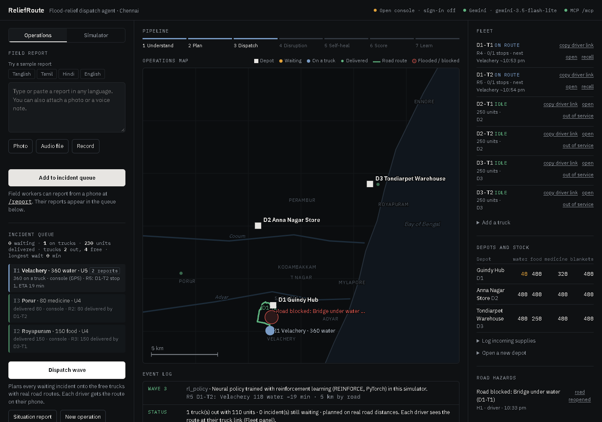
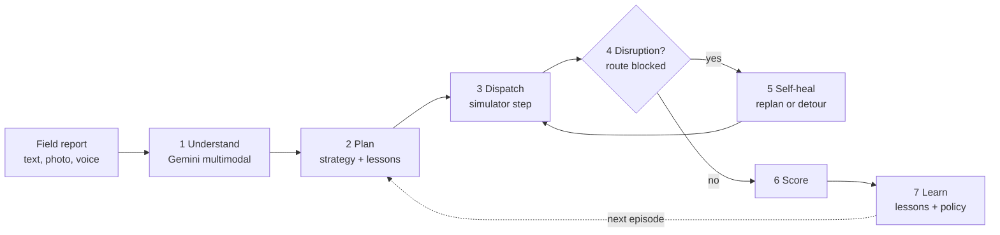
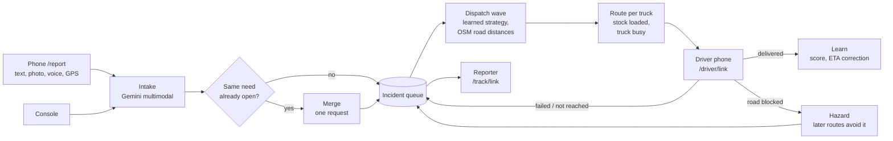
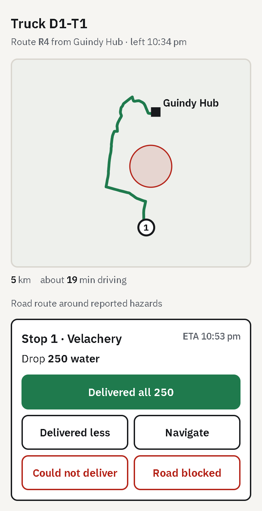
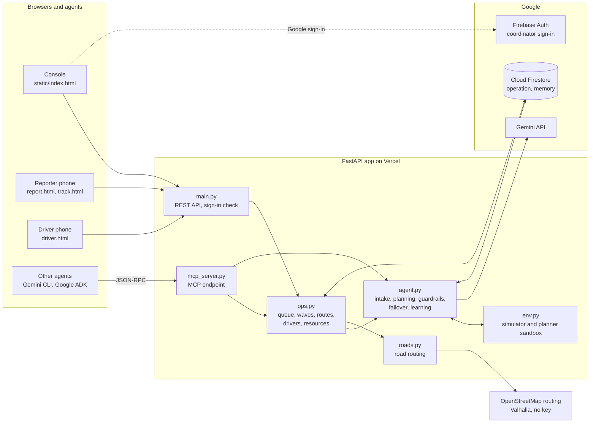
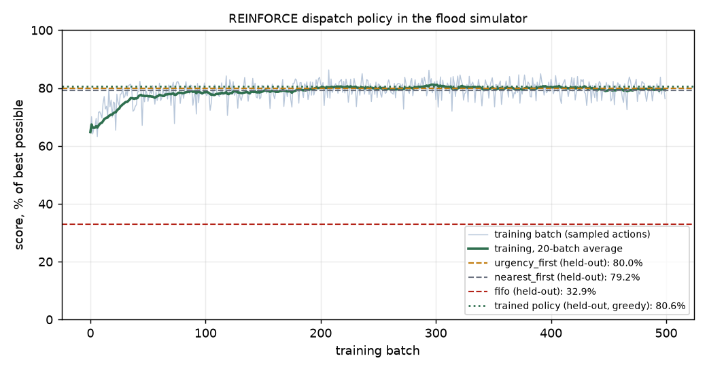

# ReliefRoute

ReliefRoute is a flood-relief logistics agent for Chennai. It takes a field report (typed text, a photo, or a voice note, in English, Tamil, Tanglish or Hindi) and handles the rest:
- it works out who needs what and how urgently
- it assigns supplies from depots and loads them onto trucks with capacity limits and multi-stop routes
- it detects when a route fails mid-delivery and replans
- it scores the outcome and learns from it before the next run, including a dispatch policy trained with reinforcement learning (PyTorch) in an OpenEnv environment

Live operations run the real loop:
1. Field workers report from a phone page, and duplicate reports of the same need are merged.
2. The coordinator dispatches waves. The agent plans them on real road distances (OpenStreetMap) that go around every reported flood.
3. Each driver gets their route on their phone and marks every stop delivered, failed or road blocked.
4. What drivers report flows back: blocked roads become hazards that later routes avoid, undelivered relief returns to the queue, and the agent learns its real ETA error.
5. Reporters follow their request on a tracking link.

Built for the Agent Wars challenge at GDG DevFest 2026.

| | |
|---|---|
| Live app (coordinator console) | https://reliefroute.vercel.app |
| Field reporter (phone page) | https://reliefroute.vercel.app/report |
| Driver and tracking pages | `/driver/<truck link>` and `/track/<report link>`: secret links handed out by the app |
| MCP endpoint | https://reliefroute.vercel.app/mcp |
| Health check | https://reliefroute.vercel.app/healthz |
| Source | https://github.com/Pranav-0710/reliefroute |
| Architecture details | [docs/architecture.md](docs/architecture.md) |



---

## The problem

During the Chennai floods, help requests arrive as WhatsApp voice notes, photos of handwritten lists and messages in mixed Tamil and English. Coordinators have to work out by hand:
- what each message is asking for
- which depot has the stock
- which roads are still open

Roads close while trucks are already moving, and the lessons from one flood are rarely written down before the next one.

ReliefRoute automates that chain from the moment a report arrives to a scored, completed delivery plan.

## What the agent does

Every dispatch runs the same seven stages. The web app lights them up as they complete.



| Stage | What happens |
|---|---|
| 1 Understand | Gemini reads the report and any attached photo or audio. It returns structured needs (area, item, quantity, urgency 1–5) and road hazards. The agent validates the output: it clamps quantities and checks that coordinates fall inside Chennai. |
| 2 Plan | The agent picks a planning strategy: Gemini, a neural policy trained with reinforcement learning, or one of three rule-based strategies. It assigns each request to a depot, in stop order. A guardrail checks every plan Gemini produces before anything moves. |
| 3 Dispatch | The simulator loads the assignments onto trucks (2 per depot, 250 units each) and drives each truck's stops in order. It moves stock and computes leg distances, arrival times and reward. |
| 4 Disruption | On the first round, a bridge collapses on the longest leg that is not already detouring. That delivery fails. |
| 5 Self-heal | The agent sees which deliveries failed or did not fit on a truck, and replans them: a detour, a different depot or the next round. It gets up to three rounds. |
| 6 Score | The reward is converted to a percentage of the best possible outcome. |
| 7 Learn | The strategy's average score is updated, and the agent writes lessons that are fed into the next plan. |

## Try it in three minutes

The console has two tabs: **Operations** (a live relief operation) and **Simulator** (single scored episodes and training).

**Operations** (a laptop for the console, a phone for the field)
1. **Report.** Open https://reliefroute.vercel.app/report on a phone, type a request (any language), share your location and send. It appears in the console's **Incident queue** within 5 seconds, tagged `PHONE`. The phone shows a **Track this request** link.
2. **Report the same need again.** Send a second report for the same item in the same area. It is merged (`MERGED`, "2 reports"), not queued twice.
3. **Dispatch.** Add one or two sample reports from the console, then click **Dispatch wave**. Each truck with stops gets a route on real roads (green line on the map, `WAVE` in the log). The stock leaves the depot, and the truck shows **on route** in the **Fleet** panel.
4. **Drive.** In **Fleet**, open a truck's driver link (or copy it to a phone). The driver sees the road route and the stops in order.
   - Tap **Road blocked** on one stop. The console logs `BLOCKED` and `REROUTE`, and the road appears under **Road hazards**.
   - Tap **Delivered** on the others. The console logs `DRIVER`, then `LEARN` when the route closes.
5. **Recover.** Click **Dispatch wave** again. The blocked request is routed around the new hazard; its route is longer than before.
6. **Follow up.** Open the reporter's tracking link to see "Truck on the way" with an ETA. Click **Situation report** for a Gemini briefing from the live data.

Under **Depots and stock** you can log incoming supplies or open a new depot by clicking the map. **Fleet** adds trucks, takes them out of service and recalls routes.

**Simulator**
1. Under **Training**, click **Run 5 episodes**. Click it a second time.
   - The agent plays ten random flood scenarios.
   - Watch the **Performance** panel: score per episode, the change against the first five runs, and which strategy the bandit now prefers (`rl_policy` is the trained neural policy).
2. Pick the **Tanglish** sample (or attach a photo, or record a voice note), then click **Run full episode**.
3. Read the result:
   - **Map:** orange dots are your report and blue dots are other open requests. Green lines are truck legs (depot to first stop, then stop to stop; hover for truck, stop number and arrival time). A red cross is the leg that broke; a dashed green line is the detour that replaced it.
   - **Event log:** each line is tagged with the stage that produced it.

| Log tag | Meaning |
|---|---|
| `INTAKE` | What Gemini extracted from the report |
| `STEP n` | The plan for that round, its reasoning, and each delivery |
| `ALERT` | A disruption happened (the bridge collapse) |
| `REROUTE` | A blocked delivery is being replanned |
| `GUARDRAIL` | The plan was corrected before dispatch (unknown depot, missing request, unsafe route) |
| `FAILOVER` | A Gemini model ran out of quota, so the agent switched model |
| `FALLBACK` | An external service failed, so the agent used a local method (rules, distance estimate) |
| `SCORE` | Outcome as a percentage of the best possible |
| `LESSON` | A lesson written to memory for the next run |
| `QUEUED`, `PHONE` | Incidents added to the operation from the console or from a phone |
| `MERGED`, `TRACKING` | A report matched an open request and was merged; the reporter's status link |
| `WAVE n`, `STATUS` | A dispatch wave: each truck's road route, and what is still waiting |
| `DRIVER`, `BLOCKED` | A driver recorded a stop as delivered, failed, or blocked by a road hazard |
| `LEARN` | A route closed and its real outcome was recorded |

## Live operations





- **Reports** from the phone page and the console go through the same multimodal intake.
  - A phone's GPS position, when inside Chennai, replaces the coordinates guessed from the text.
  - A need is merged into an open request when the item is the same, the place is the same and it was reported in the last 12 hours. "Same place" means within 0.5 km when both positions are GPS. When a position was guessed from a place name, which is only precise to the locality, the same locality (or within 1.5 km) is enough. The larger quantity and the higher urgency win, so two people describing one camp never send two trucks.
  - Every report gets a tracking link that shows the reporter only their own requests.
- **A wave** plans over every waiting incident, using only the trucks that are free, their own capacities and the depots' current stock. It uses the strategy with the best learned score (usually `rl_policy`).
  - Distances come from a road distance table computed on OpenStreetMap, with every active hazard sent as an area to avoid.
  - Each truck with stops then gets a real road route with geometry and ETAs. ETAs include 10 minutes of unloading per earlier stop, multiplied by the learned ETA correction.
  - Stock leaves the depot when the truck is loaded, and the truck stays busy until its route closes.
- **Drivers** open their truck's link and mark each stop:
  - **delivered** (in full or a smaller amount)
  - **could not deliver** (with a reason)
  - **road blocked** (with their GPS position)

  When the last stop is recorded, the route closes. Undelivered relief goes back into the queue and unused cargo back into stock.
- **The feedback loop** turns every closed route into learning:
  - **Score:** an urgency-weighted share of the loaded relief that reached people, recorded per strategy.
  - **ETA correction:** arrival times nudge a learned factor (actual time divided by the router's estimate) that every future ETA uses. Taps made seconds after dispatch are ignored, because they are not arrivals.
  - **Lessons:** failed and blocked stops become lessons for the planner.
  - **Hazards:** a blocked road becomes a hazard immediately, so the next wave routes around it. The coordinator clears it when the road reopens.
- **Resources** are managed at runtime: open depots, add trucks of any size, take trucks out of service, recall a route, log incoming supplies, close requests that need no delivery. Every change is written to the activity log with who made it.
- **The situation report** summarises the operation: priorities, trucks out, blocked roads, stock alerts and recommended actions.
  - Gemini writes it from the live data only.
  - Stock alerts are always computed exactly (items under 100 units) rather than left to Gemini.
  - If Gemini is unavailable, a rule-based report with the same sections is produced.
- **Coordinator sign-in** is optional. With it on, only listed Google accounts can dispatch, manage resources or reset, and everyone else sees a read-only console without driver links. Reporters and drivers never sign in; their links are the credential.
- **State** is one JSON document in Cloud Firestore when `FIREBASE_SERVICE_ACCOUNT` is set, shared by every server instance. Every change is a conditional write that retries if another instance changed the document first, so simultaneous reports, waves and driver updates never overwrite each other. The console polls every 5 seconds.
<br clear="right">

## Architecture



- **Agent (`agent.py`)** holds the decision logic: multimodal intake, planning strategies, the guardrail, Gemini failover, reflection, the bandit and learning from field outcomes.
- **Live operations (`ops.py`)** run the dispatch loop: queue, duplicate merging, waves, routes, driver updates, resources and situation reports. The web API and the MCP server call the same functions.
- **Simulator (`env.py`)** follows the OpenEnv contract (`reset`, `step`, `state`). Training plays thousands of episodes in it. A live wave uses it as a sandbox for planning, with the real depots, free trucks and road distances. `relief_openenv/` packages the same simulator as an OpenEnv environment server.
- **Learned policy (`policy.py`)** runs the network trained by `rl/train_policy.py` in plain Python from `policy_weights.json`, so the deployed app needs no PyTorch.
- **Road routing (`roads.py`)** asks a Valhalla server on OpenStreetMap data for distance tables and truck routes, with active hazards as areas to avoid. If it fails, it falls back to straight-line estimates and the log says so.
- **State (`store.py`)** is two JSON documents, the operation and the agent's memory, in Cloud Firestore with conditional writes, or local files for development.
- **Coordinator sign-in (`auth.py`)** verifies Firebase ID tokens (Google accounts) against a list of coordinator emails.
- **Every keyed API is Google's:** Gemini, Firestore and Firebase Authentication. Road routing uses the public OpenStreetMap Valhalla server, which needs no key. The Google Maps Routes API is still wired into the simulator for travel times when a key with that API is available.

The request lifecycle, simulator rules, scoring formula, learning loop and every failure path are documented with diagrams in [docs/architecture.md](docs/architecture.md).

## How it meets the brief

| Requirement | How ReliefRoute does it | Where |
|---|---|---|
| End to end | A phone report becomes an incident, a planned road route, a driver's stop, a delivery and a lesson. The steps in between need no human. In live operations a person stays in charge of when to dispatch and does the driving. | `ops.py`, `agent.run_episode` |
| Multimodal | Text, images and audio go to Gemini in a single call. The browser converts microphone recordings to WAV. | `agent.intake`, `static/report.html` |
| Feedback loop | In the simulator, every episode's score updates the policy and lesson memory. In live operations, drivers' outcomes update the field score per strategy, the ETA correction and the lessons, and blocked roads change the next routes. | `agent.record_field_route`, `ops.driver_update` |
| Self-learning | 1. A neural dispatch policy trained with REINFORCE (PyTorch) in the simulator. 2. An epsilon-greedy bandit learns online which strategy scores best. 3. Gemini writes lessons that are injected into later planning prompts. 4. A travel-time correction learned from drivers' real arrival times. | `rl/train_policy.py`, `agent.select_strategy`, `agent.record_field_route` |
| Self-healing | Rerouting around blocked roads (simulated collapses and drivers' reports); guardrail repair of bad plans; retries; a quota circuit breaker with model failover; a rule-based fallback for every Gemini step; straight-line estimates when the road router fails; conditional writes that retry on conflicts; duplicate reports merged instead of double-dispatched | `agent.repair`, `agent.gemini_json`, `ops.run_wave`, `store.update` |
| Google APIs | Gemini, Cloud Firestore and Firebase Authentication, all with Google keys. Road routing uses OpenStreetMap, which needs no key. | `agent.py`, `store.py`, `auth.py`, `roads.py` |
| Deployable | Live on Vercel. A Dockerfile is included for Cloud Run. | `Dockerfile` |
| MCP | The agent's tools are exposed over MCP (Streamable HTTP) | `mcp_server.py` |

## Reinforcement learning

`rl/train_policy.py` trains a dispatch policy with REINFORCE (PyTorch) by playing simulated floods. In every round it makes two decisions with two small networks (one hidden layer of 24 units each):
- **which request to load next**, which also sets each truck's stop order
- **which depot serves it**, which also picks the truck

While deciding, the policy simulates the trucks exactly as the simulator loads them. Its features therefore see:
- the real arrival time at each stop
- the leg each truck would actually drive (previous stop to next stop) and whether that leg crosses a flood
- the space left on the truck, stock coverage, and how scarce the item is

Training uses a **group-relative baseline**, as in GRPO: each scenario is played 8 times, and every attempt is judged against the other attempts on the same scenario, so easy and hard scenarios no longer blur the signal. The run used 32,000 episodes on a laptop CPU.

Evaluation uses 500 scenarios the policy never saw during training, all with the mid-delivery bridge collapse switched on:

| Strategy | Average score on 500 held-out scenarios |
|---|---|
| Trained policy (`rl_policy`) | **80.6%** |
| Same networks before training | 78.0% |
| `urgency_first` (best hand-written rule) | 80.0% |
| `nearest_first` | 79.2% |
| `fifo` (naive baseline) | 32.9% |

Paired on the same 500 scenarios, the trained policy beats `urgency_first` by **+0.57 points (95% CI +0.33 to +0.81)**. It wins 155 scenarios, ties 238 and loses 107. The edge is small but statistically clear.

How much room was there? Choosing the best of 40 sampled plans per scenario, with hindsight, reaches about 82.5% (measured on 100 of these scenarios). So the best hand-written rule was already close to the ceiling of this simulator.

Most of the jump over the previous version (55.7% untrained, 80.2% trained) came from the truck-aware decision procedure itself: even untrained, it scores 78.0%.

The exported weights reproduce the PyTorch result exactly (80.6%) in pure Python, and that is what the live app runs as the `rl_policy` strategy.



To retrain:

```bash
pip install -r requirements-train.txt
python rl/train_policy.py --episodes 32000 --batch 64 --group 8 --hidden 24 --lr 0.005
```

This writes `policy_weights.json`, `rl/results.json` and `docs/rl_training.png`.

## OpenEnv environment

`relief_openenv/` packages the simulator as a standard [OpenEnv](https://github.com/huggingface/OpenEnv) environment:
- typed `ReliefAction`, `ReliefObservation` and `ReliefState` models
- a server built with OpenEnv's `create_app`
- a typed `ReliefEnvClient`
- an `openenv.yaml` manifest that passes `openenv validate --level static`

Any OpenEnv-compatible trainer can therefore use it, for example TRL's GRPO.

```bash
pip install "openenv>=0.9"
uvicorn relief_openenv.server.app:app --port 8001
```

```python
from relief_openenv import Assignment, ReliefAction, ReliefEnvClient

with ReliefEnvClient(base_url="http://localhost:8001").sync() as env:
    result = env.reset(seed=7)
    while not result.done:
        plan = [Assignment(need_id=n["id"], depot_id="D1") for n in result.observation.pending_needs]
        result = env.step(ReliefAction(assignments=plan))
    print(result.observation.score)
```

Episodes run over OpenEnv's WebSocket session, one simulator per session. To build a container (from the repository root): `docker build -f relief_openenv/server/Dockerfile -t reliefroute-openenv .`

## Run it locally

Requirements: Python 3.10 or newer. A Gemini API key from https://aistudio.google.com/apikey is optional; without one, the agent runs entirely on its rule-based fallbacks.

```bash
git clone https://github.com/Pranav-0710/reliefroute.git
cd reliefroute
python -m venv .venv
```

Activate the environment. On Windows (PowerShell):

```powershell
.venv\Scripts\Activate.ps1
$env:GEMINI_API_KEY = "your-key"
```

On macOS or Linux:

```bash
source .venv/bin/activate
export GEMINI_API_KEY="your-key"
```

Install the dependencies and start the server:

```bash
pip install -r requirements.txt
uvicorn main:app --port 8080
```

Open http://localhost:8080.

| Variable | Required | Default | Purpose |
|---|---|---|---|
| `GEMINI_API_KEY` | no | – | Enables Gemini. `GOOGLE_API_KEY` also works. |
| `MAPS_API_KEY` | no | the Gemini key | Key for the Maps Routes API |
| `GEMINI_MODELS` | no | `gemini-flash-latest,gemini-3.8-flash,gemini-3.5-flash-lite` | Order in which models are tried |
| `MEMORY_PATH` | no | `memory.json` (`/tmp/memory.json` on Vercel) | Where memory is stored |
| `OFFLINE` | no | – | Set to `1` to force rule-based mode, even when a key is present |
| `FIREBASE_SERVICE_ACCOUNT` | for a deployment | – | Service-account key JSON (raw or base64). When set, memory and the live operation are stored in Cloud Firestore and shared by every server instance; otherwise local JSON files are used. |
| `GEMINI_DAILY_BUDGET` | no | `300` | Gemini calls one server instance may make per UTC day. Past it, the agent uses its rule-based fallbacks. |
| `ROUTER_URL` | no | `https://valhalla1.openstreetmap.de` | Valhalla road router. `off` disables road routing (straight-line estimates). |
| `COORDINATOR_EMAILS` | no | – | Comma-separated Google accounts allowed to coordinate. Together with `FIREBASE_WEB_API_KEY` it turns coordinator sign-in on. |
| `FIREBASE_WEB_API_KEY` | no | – | The Firebase web app's `apiKey` (public by design) |
| `FIREBASE_PROJECT_ID` | no | the service account's project | Firebase project for sign-in |
| `OPS_PATH` | no | `ops.json` (`/tmp/ops.json` on Vercel) | Where the live operation is stored without Firestore |

### Tests

```bash
pytest -q
```

The 28 tests run without network access or an API key. Gemini, the road router and Firebase sign-in are replaced by fakes. The OpenEnv test is skipped if the `openenv` package isn't installed. They cover:
- the simulator contract and truck rules: capacity, stop order, arrival times, a full fleet
- recovery after a blocked route
- guardrail repair
- the trained policy running without PyTorch
- the bandit learning to avoid the weakest strategy
- scores staying within 0–100% across 120 episodes
- the quota circuit breaker and the daily Gemini budget
- per-client rate limits
- keyword intake
- the MCP handshake and tool calls
- the OpenEnv environment and server
- Firestore conditional writes under a concurrent update
- live operations:
  - phone reports placed by GPS, with a working tracking link
  - duplicate reports merged
  - waves loading stock and sending trucks out
  - drivers delivering in full or in part, failing, or reporting a blocked road, and what each one does to the queue, stock, hazards and memory
  - the learned ETA correction
  - recalls, depots, trucks, restocks and closing requests, with their guards
  - hazards sent to the router as areas to avoid, and the fallback when the router is down
  - coordinator sign-in protecting every change, and driver links hidden from the public view
  - the situation report and its fallback
- the full web flow

## Use it from another agent (MCP)

The MCP endpoint is stateless Streamable HTTP with JSON responses.

| Tool | Input | Returns |
|---|---|---|
| `parse_field_report` | `text` | Structured needs and hazards |
| `dispatch_relief` | `text`, optional `chaos` | Deliveries, self-heal events, score and new lessons |
| `train_agent` | optional `episodes` (1–5) | Strategy and score for each episode |
| `get_operation` | – | Live figures, waiting incidents, trucks on routes with their stops, active hazards |
| `get_memory` | – | Lessons, policy statistics and recent scores |

List the tools:

```bash
curl -s https://reliefroute.vercel.app/mcp -H "Content-Type: application/json" -d '{"jsonrpc":"2.0","id":1,"method":"tools/list"}'
```

Call a tool:

```bash
curl -s https://reliefroute.vercel.app/mcp -H "Content-Type: application/json" -d '{"jsonrpc":"2.0","id":2,"method":"tools/call","params":{"name":"dispatch_relief","arguments":{"text":"Adyar: 200 people need drinking water, urgent"}}}'
```

Gemini CLI (`~/.gemini/settings.json`):

```json
{ "mcpServers": { "reliefroute": { "httpUrl": "https://reliefroute.vercel.app/mcp" } } }
```

Google ADK:

```python
from google.adk.tools.mcp_tool import McpToolset
from google.adk.tools.mcp_tool.mcp_session_manager import StreamableHTTPConnectionParams

reliefroute = McpToolset(connection_params=StreamableHTTPConnectionParams(url="https://reliefroute.vercel.app/mcp"))
```

## HTTP API

| Method | Path | Purpose |
|---|---|---|
| `GET` | `/` | Web app |
| `GET` | `/healthz` | Status, whether Gemini and the trained policy are available, model order, today's Gemini budget use |
| `POST` | `/api/dispatch` | Multipart form: `text`, `chaos`, optional `image`, `audio`, `memory`. Runs one full episode for the report. |
| `POST` | `/api/train` | JSON `{"episodes": 1-20, "chaos": true}`. Runs simulated episodes. |
| `GET` | `/api/scenario` | A sample scenario for the initial map |
| `GET` | `/api/memory` | Current memory |
| `POST` | `/api/memory/reset` | Clear memory (coordinator) |
| `POST` | `/mcp` | MCP JSON-RPC endpoint |
| `GET` | `/api/config`, `/api/me` | Sign-in configuration for the browser; whether the caller is a coordinator |
| `GET` | `/report` | Field reporter phone page |
| `POST` | `/api/reports` | Multipart form: `text`, optional `image`, `audio`, `lat`, `lng`, `source`. Adds or merges incidents and returns a `track_url`. |
| `GET` | `/api/ops` | Operation state and summary figures. Driver links only for coordinators. |
| `POST` | `/api/ops/wave` | Plans and sends out one wave over all waiting incidents (coordinator). 409 if nothing is waiting or no truck is free. |
| `POST` | `/api/ops/sitrep` | Situation report as text plus structured sections (coordinator) |
| `POST` | `/api/ops/reset` | Starts a new operation (coordinator) |
| `POST` | `/api/ops/depots` | JSON `{"name", "lat", "lng"}`: opens a depot (coordinator) |
| `POST`, `PATCH` | `/api/ops/trucks`, `/api/ops/trucks/{id}` | Adds a truck `{"depot_id", "capacity"}`; changes `capacity` or `in_service` (coordinator) |
| `POST` | `/api/ops/restock` | JSON `{"depot_id", "item", "qty", "note"}`: logs incoming supplies (coordinator) |
| `POST` | `/api/ops/routes/{id}/recall` | Ends a route early; unvisited stops return to the queue (coordinator) |
| `POST` | `/api/ops/hazards/{id}/clear` | Marks a road reopened (coordinator) |
| `POST` | `/api/ops/incidents/{id}/close` | JSON `{"reason"}`: closes a request that needs no delivery (coordinator) |
| `GET` | `/driver/{token}`, `/api/driver/{token}` | Driver page and the truck's current route |
| `POST` | `/api/driver/{token}/stops/{n}` | JSON `{"outcome": "delivered" \| "failed" \| "blocked", "qty", "note", "lat", "lng"}` |
| `GET` | `/track/{token}`, `/api/track/{token}` | Reporter's status page and data |

"(coordinator)" means a signed-in coordinator when sign-in is on; with it off, the console is open to anyone with the link.

Each client address is limited, per 10 minutes, to:

| Action | Limit |
|---|---|
| Single-episode dispatches | 8 |
| Field reports | 12 |
| Waves | 30 |
| Situation reports | 6 |
| Training requests | 60 |
| Resource changes | 60 |
| Driver stop updates | 120 |
| Costly MCP tool calls | 10 |
| Resets | 5 |

Over a limit, the server returns HTTP 429 with a `Retry-After` header.

## Repository layout

| Path | Contents |
|---|---|
| `env.py` | Flood simulator: depots, trucks, requests, floods, the bridge collapse, reward |
| `agent.py` | Intake, planning strategies, guardrail, Gemini failover and budget, Maps ETAs, reflection, bandit, memory |
| `policy.py` | Learned policy: features, decision procedure, pure-Python inference |
| `policy_weights.json` | Trained policy weights |
| `rl/train_policy.py`, `rl/results.json` | PyTorch REINFORCE training and its evaluation results |
| `relief_openenv/` | The simulator as an OpenEnv environment: models, server, client, manifest, Dockerfile |
| `main.py` | FastAPI server: web app, REST API, MCP route, sign-in checks, rate limits |
| `mcp_server.py` | MCP protocol handling and tool definitions |
| `ops.py` | Live operations: queue and merging, waves, routes, drivers, resources, tracking, situation reports |
| `roads.py` | Road distance tables and truck routes on OpenStreetMap (Valhalla), hazards avoided |
| `auth.py` | Coordinator sign-in: Firebase ID token verification |
| `store.py` | Storage: Cloud Firestore over REST with conditional writes, or local JSON files |
| `static/index.html` | The coordinator console with Operations and Simulator tabs (single file, no build step) |
| `static/report.html`, `static/track.html` | The field reporter phone page and the reporter's status page |
| `static/driver.html` | The driver's route page |
| `test_app.py` | Automated tests |
| `Dockerfile` | Container image for Cloud Run or any container host |
| `docs/architecture.md` | Diagrams and technical reference |

## Deployment

The live app runs on Vercel, which detects the FastAPI app in `main.py` automatically:

```bash
npx vercel deploy --prod
```

Set these under the project's Environment Variables first:
- `GEMINI_API_KEY`
- `FIREBASE_SERVICE_ACCOUNT`: a service-account key from a Firebase project with a Firestore database (the free Spark plan is enough)

The live deployment also sets `GEMINI_MODELS=gemini-3.5-flash-lite,gemini-flash-latest,gemini-3.8-flash`, which starts with the model that has the most free-tier quota.

To turn on coordinator sign-in:
1. In the same Firebase project, open **Authentication → Sign-in method** and enable **Google**.
2. Under **Authentication → Settings → Authorized domains**, add your deployment's domain.
3. Under **Project settings → General → Your apps**, register a web app and copy its `apiKey`.
4. Set `FIREBASE_WEB_API_KEY` to that key and `COORDINATOR_EMAILS` to the coordinators' Google accounts.

To run on Google Cloud Run instead, use the included Dockerfile. This needs a project with billing enabled:

```bash
gcloud run deploy reliefroute --source . --region asia-south1 --allow-unauthenticated --set-env-vars GEMINI_API_KEY=your-key
```

## Known limitations

- **Road routing uses a public server.** Live routes come from the public FOSSGIS Valhalla instance on OpenStreetMap data. It is free, has no service guarantee, and asks for fair use; a real deployment should run its own Valhalla (`ROUTER_URL`). Drive times assume normal roads, so the learned ETA correction is what adapts them to flood conditions. When the router is unreachable, the agent plans on straight-line estimates and says so. The Google Maps Routes API is not used for live routes: it needs a Google Cloud project with billing, and ours is closed.
- **Hazards are circles.** A reported flood or a driver's blocked road is an area of fixed radius (0.8 km for reports, 0.5 km from drivers), not the exact flooded segment. A hazard that covers a stop itself cannot be avoided and is not sent to the router.
- **Gemini quota is limited.** The deployment uses the Gemini free tier, which allows few requests per day. When a model is exhausted, the circuit breaker moves to the next one. If every model is exhausted, the agent continues on rule-based intake and planning, which only understands English keywords and known area names.
- **Duplicate detection is a rule.** Same item, same place (0.5 km between GPS positions; the same locality when a position is guessed from the text), within 12 hours. Two genuinely different groups in one locality reported without GPS are merged; the coordinator sees the report count on the request and can still dispatch more.
- **Links are the credentials for drivers and reporters.** Anyone holding a truck's driver link can record its stops, and a new operation issues new links. Coordinator sign-in is off until it is configured (see Deployment); while it is off, anyone with the console link can dispatch and reset. Rate limits and the daily Gemini budget are kept per server instance.
- **The simulator data is simulated.** In the Simulator tab, depot stock, the other requests, flood zones and the bridge collapse are generated, and distances are straight lines times 1.3. Live operations use real roads but start from three example depots with 400 units of each item.
- **The RL policy is trained offline and is small.** Its weights are updated in training, not while the app runs; online learning is the bandit, the lessons and the field feedback. It matches the best hand-written rule rather than clearly beating it. Gemini itself is not fine-tuned.
- **One document per operation.** The live operation is a single Firestore document (limit 1 MiB). Old routes drop their road geometry to stay small, which is enough for thousands of incidents but not for a city-wide operation over weeks.

## Next steps

- Train a small open language model as the planner with GRPO (Hugging Face TRL) against the `relief_openenv` server.
- Retrain the RL policy on real road distances and on the field outcomes collected by live operations.
- Use the Google Route Optimization API (or a self-hosted solver) for the truck routes once a billed project is available.
- Split the operation into per-incident documents for very large operations, and add per-organisation workspaces.
- Connect real depot inventory and an SMS or WhatsApp intake line.

## Author

Built by jey pranav ([@Pranav-0710](https://github.com/Pranav-0710)).

## License

MIT. See [LICENSE](LICENSE).
