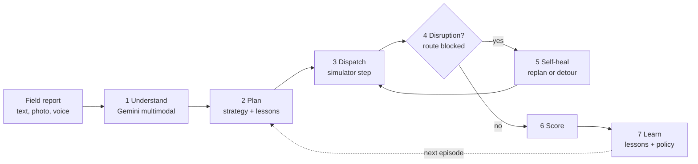
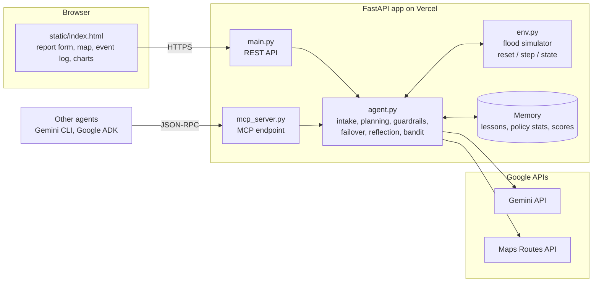

# ReliefRoute

ReliefRoute is a flood-relief logistics agent for Chennai. It takes a field report (typed text, a photo, or a voice note, in English, Tamil, Tanglish or Hindi) and handles the rest:
- it works out who needs what and how urgently
- it assigns supplies from depots and loads them onto trucks with capacity limits and multi-stop routes
- it detects when a route fails mid-delivery and replans
- it scores the outcome and learns from it before the next run, including a dispatch policy trained with reinforcement learning (PyTorch) in an OpenEnv environment

Built for the Agent Wars challenge at GDG DevFest 2026.

| | |
|---|---|
| Live app | https://reliefroute.vercel.app |
| MCP endpoint | https://reliefroute.vercel.app/mcp |
| Health check | https://reliefroute.vercel.app/healthz |
| Source | https://github.com/Pranav-0710/reliefroute |
| Architecture details | [docs/architecture.md](docs/architecture.md) |


---

## The problem

During the Chennai floods, help requests arrive as WhatsApp voice notes, photos of handwritten lists and messages in mixed Tamil and English. Coordinators have to work out by hand:
- what each message is asking for
- which depot has the stock
- which roads are still open

Roads close while trucks are already moving, and the lessons from one flood are rarely written down before the next one.

ReliefRoute automates that chain from the moment a report arrives to a scored, completed delivery plan.

## What the agent does

Every dispatch runs the same seven stages. The web app lights them up as they complete.



| Stage | What happens |
|---|---|
| 1 Understand | Gemini reads the report and any attached photo or audio. It returns structured needs (area, item, quantity, urgency 1–5) and road hazards. The agent validates the output: it clamps quantities and checks that coordinates fall inside Chennai. |
| 2 Plan | The agent picks a planning strategy: Gemini, a neural policy trained with reinforcement learning, or one of three rule-based strategies. It assigns each request to a depot, in stop order. A guardrail checks every plan Gemini produces before anything moves. |
| 3 Dispatch | The simulator loads the assignments onto trucks (2 per depot, 250 units each) and drives each truck's stops in order. It moves stock and computes leg distances, arrival times and reward. |
| 4 Disruption | On the first round, a bridge collapses on the longest leg that is not already detouring. That delivery fails. |
| 5 Self-heal | The agent sees which deliveries failed or did not fit on a truck, and replans them: a detour, a different depot or the next round. It gets up to three rounds. |
| 6 Score | The reward is converted to a percentage of the best possible outcome. |
| 7 Learn | The strategy's average score is updated, and the agent writes lessons that are fed into the next plan. |

## Try it in three minutes

1. Open https://reliefroute.vercel.app.
2. Under **Training**, click **Run 5 episodes**. Click it a second time.
   - The agent plays ten random flood scenarios.
   - Watch the **Performance** panel: score per episode, the change against the first five runs, and which strategy the bandit now prefers (`rl_policy` is the trained neural policy).
3. Under **Field report**, click the **Tanglish** sample (or attach a photo, or record a voice note), then click **Dispatch**.
4. Read the result:
   - **Map:** orange dots are your report and blue dots are other open requests. Green lines are truck legs (depot to first stop, then stop to stop; hover for truck, stop number and arrival time). A red cross is the leg that broke; a dashed green line is the detour that replaced it.
   - **Event log:** each line is tagged with the stage that produced it.

| Log tag | Meaning |
|---|---|
| `INTAKE` | What Gemini extracted from the report |
| `STEP n` | The plan for that round, its reasoning, and each delivery |
| `ALERT` | A disruption happened (the bridge collapse) |
| `REROUTE` | A blocked delivery is being replanned |
| `GUARDRAIL` | The plan was corrected before dispatch (unknown depot, missing request, unsafe route) |
| `FAILOVER` | A Gemini model ran out of quota, so the agent switched model |
| `FALLBACK` | An external service failed, so the agent used a local method (rules, distance estimate) |
| `SCORE` | Outcome as a percentage of the best possible |
| `LESSON` | A lesson written to memory for the next run |

## Architecture



- **Agent (`agent.py`)** holds all the decision logic. Both the web API and the MCP server call the same functions.
- **Simulator (`env.py`)** follows the OpenEnv contract (`reset`, `step`, `state`). It runs in-process, so an episode with the rule-based strategies takes milliseconds. `relief_openenv/` packages the same simulator as an OpenEnv environment server.
- **Learned policy (`policy.py`)** runs the network trained by `rl/train_policy.py` in plain Python from `policy_weights.json`, so the deployed app needs no PyTorch.
- **Memory** is a JSON document: lessons, per-strategy statistics and episode history. The browser keeps a copy and sends it back with each request. If a serverless instance restarts and loses its copy, learning is restored from the browser.
- **External calls go only to Google APIs:** Gemini for understanding, planning and reflection, and the Maps Routes API for travel times.

The request lifecycle, simulator rules, scoring formula, learning loop and every failure path are documented with diagrams in [docs/architecture.md](docs/architecture.md).

## How it meets the brief

| Requirement | How ReliefRoute does it | Where |
|---|---|---|
| End to end | One request goes from raw report to understood needs, plan, dispatch, recovery, score and lesson, with no human step | `agent.run_episode` |
| Multimodal | Text, images and audio go to Gemini in a single call. The browser converts microphone recordings to WAV. | `agent.intake`, `static/index.html` |
| Feedback loop | Every episode's score updates the policy and the lesson memory, and both shape the next episode | `agent.run_episode`, `agent.reflect` |
| Self-learning | 1. A neural dispatch policy trained with REINFORCE (PyTorch) in the simulator: weights updated over 6,000 episodes. 2. An epsilon-greedy bandit learns online which strategy scores best. 3. Gemini writes lessons that are injected into later planning prompts. | `rl/train_policy.py`, `agent.select_strategy`, `agent.llm_plan` |
| Self-healing | Replanning after blocked routes; guardrail repair of bad plans; retries; a quota circuit breaker with model failover; a rule-based fallback for every Gemini step; distance estimates when Maps fails; memory restore after cold starts | `agent.repair`, `agent.gemini_json`, `agent.maps_eta`, `agent.sync_memory` |
| Google APIs only | Gemini API and Google Maps Routes API, called with Google API keys | `agent.py` |
| Deployable | Live on Vercel. A Dockerfile is included for Cloud Run. | `Dockerfile` |
| MCP | The agent's tools are exposed over MCP (Streamable HTTP) | `mcp_server.py` |

## Reinforcement learning

`rl/train_policy.py` trains a dispatch policy with REINFORCE (PyTorch) by playing simulated floods. In every round it makes two decisions with two small networks (one hidden layer of 16 units each):
- **which request to load next**, which also sets the truck stop order
- **which depot serves it**

The inputs are hand-built features: urgency, quantity, effective distance, whether the route is flooded, stock coverage and how scarce the item is. Training used 6,000 episodes (about 4 minutes on a laptop CPU). Evaluation uses 500 scenarios the policy never saw during training, all with the mid-delivery bridge collapse switched on:

| Strategy | Average score on 500 held-out scenarios |
|---|---|
| Trained policy (`rl_policy`) | **80.2%** |
| Same networks before training | 55.7% |
| `urgency_first` (best hand-written rule) | 80.0% |
| `nearest_first` | 79.2% |
| `fifo` (naive baseline) | 32.9% |

From scratch, the policy learns to match the best hand-written rule: it goes from 55.7% to 80.2%. It does not yet clearly beat that rule. The exported weights reproduce the PyTorch result exactly (80.2%) in pure Python, and that is what the live app runs as the `rl_policy` strategy.


To retrain:

```bash
pip install -r requirements-train.txt
python rl/train_policy.py --episodes 6000
```

This writes `policy_weights.json`, `rl/results.json` and `docs/rl_training.png`.

## OpenEnv environment

`relief_openenv/` packages the simulator as a standard [OpenEnv](https://github.com/huggingface/OpenEnv) environment:
- typed `ReliefAction`, `ReliefObservation` and `ReliefState` models
- a server built with OpenEnv's `create_app`
- a typed `ReliefEnvClient`
- an `openenv.yaml` manifest that passes `openenv validate --level static`

Any OpenEnv-compatible trainer can therefore use it, for example TRL's GRPO.

```bash
pip install "openenv>=0.9"
uvicorn relief_openenv.server.app:app --port 8001
```

```python
from relief_openenv import Assignment, ReliefAction, ReliefEnvClient

with ReliefEnvClient(base_url="http://localhost:8001").sync() as env:
    result = env.reset(seed=7)
    while not result.done:
        plan = [Assignment(need_id=n["id"], depot_id="D1") for n in result.observation.pending_needs]
        result = env.step(ReliefAction(assignments=plan))
    print(result.observation.score)
```

Episodes run over OpenEnv's WebSocket session, one simulator per session. To build a container (from the repository root): `docker build -f relief_openenv/server/Dockerfile -t reliefroute-openenv .`

## Run it locally

Requirements: Python 3.10 or newer. A Gemini API key from https://aistudio.google.com/apikey is optional; without one, the agent runs entirely on its rule-based fallbacks.

```bash
git clone https://github.com/Pranav-0710/reliefroute.git
cd reliefroute
python -m venv .venv
```

Activate the environment. On Windows (PowerShell):

```powershell
.venv\Scripts\Activate.ps1
$env:GEMINI_API_KEY = "your-key"
```

On macOS or Linux:

```bash
source .venv/bin/activate
export GEMINI_API_KEY="your-key"
```

Install the dependencies and start the server:

```bash
pip install -r requirements.txt
uvicorn main:app --port 8080
```

Open http://localhost:8080.

| Variable | Required | Default | Purpose |
|---|---|---|---|
| `GEMINI_API_KEY` | no | – | Enables Gemini. `GOOGLE_API_KEY` also works. |
| `MAPS_API_KEY` | no | the Gemini key | Key for the Maps Routes API |
| `GEMINI_MODELS` | no | `gemini-flash-latest,gemini-3.8-flash,gemini-3.5-flash-lite` | Order in which models are tried |
| `MEMORY_PATH` | no | `memory.json` (`/tmp/memory.json` on Vercel) | Where memory is stored |
| `OFFLINE` | no | – | Set to `1` to force rule-based mode, even when a key is present |
| `GEMINI_DAILY_BUDGET` | no | `300` | Gemini calls one server instance may make per UTC day. Past it, the agent uses its rule-based fallbacks. |

### Tests

```bash
pytest -q
```

The 19 tests run without network access or an API key. The OpenEnv test is skipped if the `openenv` package isn't installed. They cover:
- the simulator contract and truck rules: capacity, stop order, arrival times, a full fleet
- recovery after a blocked route
- guardrail repair
- the trained policy running without PyTorch
- the bandit learning to avoid the weakest strategy
- scores staying within 0–100% across 120 episodes
- memory restore after a cold start
- the quota circuit breaker and the daily Gemini budget
- per-client rate limits
- keyword intake
- the MCP handshake and tool calls
- the OpenEnv environment and server
- the full web flow

## Use it from another agent (MCP)

The MCP endpoint is stateless Streamable HTTP with JSON responses.

| Tool | Input | Returns |
|---|---|---|
| `parse_field_report` | `text` | Structured needs and hazards |
| `dispatch_relief` | `text`, optional `chaos` | Deliveries, self-heal events, score and new lessons |
| `train_agent` | optional `episodes` (1–5) | Strategy and score for each episode |
| `get_memory` | – | Lessons, policy statistics and recent scores |

List the tools:

```bash
curl -s https://reliefroute.vercel.app/mcp -H "Content-Type: application/json" -d '{"jsonrpc":"2.0","id":1,"method":"tools/list"}'
```

Call a tool:

```bash
curl -s https://reliefroute.vercel.app/mcp -H "Content-Type: application/json" -d '{"jsonrpc":"2.0","id":2,"method":"tools/call","params":{"name":"dispatch_relief","arguments":{"text":"Adyar: 200 people need drinking water, urgent"}}}'
```

Gemini CLI (`~/.gemini/settings.json`):

```json
{ "mcpServers": { "reliefroute": { "httpUrl": "https://reliefroute.vercel.app/mcp" } } }
```

Google ADK:

```python
from google.adk.tools.mcp_tool import McpToolset
from google.adk.tools.mcp_tool.mcp_session_manager import StreamableHTTPConnectionParams

reliefroute = McpToolset(connection_params=StreamableHTTPConnectionParams(url="https://reliefroute.vercel.app/mcp"))
```

## HTTP API

| Method | Path | Purpose |
|---|---|---|
| `GET` | `/` | Web app |
| `GET` | `/healthz` | Status, whether Gemini and the trained policy are available, model order, today's Gemini budget use |
| `POST` | `/api/dispatch` | Multipart form: `text`, `chaos`, optional `image`, `audio`, `memory`. Runs one full episode for the report. |
| `POST` | `/api/train` | JSON `{"episodes": 1-20, "chaos": true}`. Runs simulated episodes. |
| `GET` | `/api/scenario` | A sample scenario for the initial map |
| `GET` | `/api/memory` | Current memory |
| `POST` | `/api/memory/reset` | Clear memory |
| `POST` | `/mcp` | MCP JSON-RPC endpoint |

The public deployment limits each client address to 8 dispatches, 60 training requests, 10 costly MCP tool calls and 5 memory resets per 10 minutes. Over the limit, the server returns HTTP 429 with a `Retry-After` header.

## Repository layout

| Path | Contents |
|---|---|
| `env.py` | Flood simulator: depots, trucks, requests, floods, the bridge collapse, reward |
| `agent.py` | Intake, planning strategies, guardrail, Gemini failover and budget, Maps ETAs, reflection, bandit, memory |
| `policy.py` | Learned policy: features, decision procedure, pure-Python inference |
| `policy_weights.json` | Trained policy weights |
| `rl/train_policy.py`, `rl/results.json` | PyTorch REINFORCE training and its evaluation results |
| `relief_openenv/` | The simulator as an OpenEnv environment: models, server, client, manifest, Dockerfile |
| `main.py` | FastAPI server: web app, REST API, MCP route, rate limits |
| `mcp_server.py` | MCP protocol handling and tool definitions |
| `static/index.html` | The operations console (single file, no build step) |
| `test_app.py` | Automated tests |
| `Dockerfile` | Container image for Cloud Run or any container host |
| `docs/architecture.md` | Diagrams and technical reference |

## Deployment

The live app runs on Vercel, which detects the FastAPI app in `main.py` automatically:

```bash
npx vercel deploy --prod
```

Set `GEMINI_API_KEY` under the project's Environment Variables first. The live deployment sets `GEMINI_MODELS=gemini-3.5-flash-lite,gemini-flash-latest,gemini-3.8-flash`, which starts with the model that has the most free-tier quota.

To run on Google Cloud Run instead, use the included Dockerfile. This needs a project with billing enabled:

```bash
gcloud run deploy reliefroute --source . --region asia-south1 --allow-unauthenticated --set-env-vars GEMINI_API_KEY=your-key
```

## Known limitations

- **Google Maps travel times are not live yet.** The Routes API call is implemented, but the deployed key is not authorised for that API (it returns `401`). Enabling the Routes API requires a Google Cloud project with billing, and ours is closed. The agent falls back to distance estimates, and the log labels those ETAs "estimate". Setting `MAPS_API_KEY` to a key with the Routes API enabled switches to real travel times with no code change.
- **Gemini quota is limited.** The deployment uses the Gemini free tier, which allows few requests per day. When a model is exhausted, the circuit breaker moves to the next one. If every model is exhausted, the agent continues on rule-based intake and planning, which only understands English keywords and known area names.
- **The scenario data is simulated.** Depot stock, the other requests, flood zones and the bridge collapse are all simulated. Locations are real Chennai localities with approximate coordinates. Distances are straight-line multiplied by a 1.3 road factor, not a road network.
- **Memory is not durable.** It is a JSON file on the serverless instance, plus a copy in each browser. It is not reliably shared between instances or users. A production version would store it in Firestore.
- **The RL policy is trained offline and is small.** Its weights are updated in training, not while the app runs; online learning is the bandit and the Gemini lessons. It matches the best hand-written rule rather than clearly beating it. Gemini itself is not fine-tuned.
- **There is no authentication.** Anyone with the link can run dispatches and reset memory. Per-address rate limits and a daily Gemini budget cap the damage, but both are kept per server instance. The MCP server is minimal: tools only, no sessions or streaming.

## Next steps

- Train a small open language model as the planner with GRPO (Hugging Face TRL) against the `relief_openenv` server.
- Give the RL policy truck-aware features (load, current position) so it can learn routing that beats the rules.
- Store memory in Firestore so learning is shared and durable.
- Use the Routes API route matrix for real road distances, and the Route Optimization API for the truck routes.
- Connect real depot inventory and a phone or SMS intake line.
- Add authentication and per-organisation memory.

## Author

Built by jey pranav ([@Pranav-0710](https://github.com/Pranav-0710)).

## License

MIT. See [LICENSE](LICENSE).
