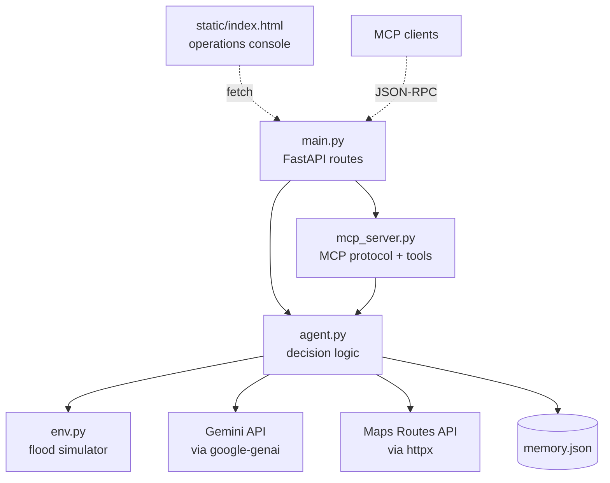
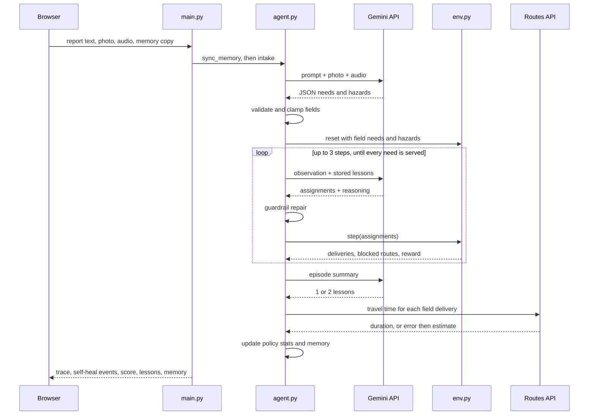
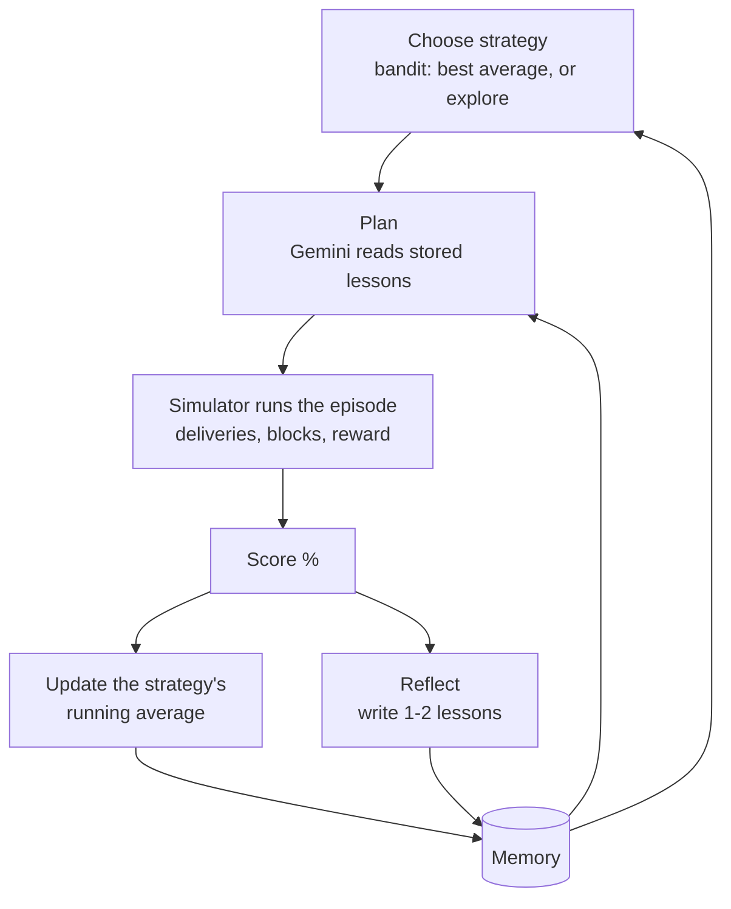
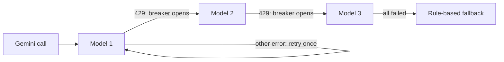

# ReliefRoute architecture

This document explains how ReliefRoute works internally. For setup and a quick tour, see the [README](../README.md).

1. [Modules](#1-modules)
2. [Lifecycle of a dispatch](#2-lifecycle-of-a-dispatch)
3. [The simulator](#3-the-simulator)
4. [Reward and score](#4-reward-and-score)
5. [Planning strategies and the guardrail](#5-planning-strategies-and-the-guardrail)
6. [The learning loop](#6-the-learning-loop)
7. [Self-healing](#7-self-healing)
8. [Multimodal intake](#8-multimodal-intake)
9. [MCP server](#9-mcp-server)
10. [Deployment and state](#10-deployment-and-state)
11. [Tests](#11-tests)

---

## 1. Modules



| Module | Responsibility |
|---|---|
| `env.py` | Builds a flood scenario, executes delivery plans, injects the disruption, computes the reward. Pure Python, no I/O. |
| `agent.py` | Everything the agent decides: intake, strategy choice, planning, plan repair, model failover, travel times, reflection, memory. |
| `main.py` | HTTP layer. Turns requests into calls on `agent.py` and returns JSON. |
| `mcp_server.py` | Implements the MCP methods and maps four tools onto `agent.py`. |
| `static/index.html` | The console: report form, pipeline, map, event log, performance panel. One file, no build step. |

## 2. Lifecycle of a dispatch

What happens when someone submits a report on the web app (`POST /api/dispatch`):



If any Gemini call fails, that step falls back to a local method instead of failing the request (see [section 7](#7-self-healing)). With the free-tier model, a typical dispatch takes 6–10 seconds.

## 3. The simulator

`env.ReliefEnv` follows the OpenEnv environment contract, so the same environment can later back RL training.

| Method | Returns |
|---|---|
| `reset(seed, extra_needs, extra_hazards, chaos, n_needs=5)` | Initial observation |
| `step(action)` | `{"observation", "reward", "done", "info"}` |
| `state()` | Full episode state, including history and total reward |

**Action**

```json
{"assignments": [{"need_id": "R1", "depot_id": "D2", "detour": false}]}
```

**Observation**

| Field | Contents |
|---|---|
| `depots` | Id, name, coordinates, current stock per item |
| `pending_needs` | Unserved requests: zone, coordinates, item, remaining quantity, urgency 1–5, source (`sim` or `field`) |
| `known_hazards` | Flood zones and collapses reported so far |
| `route_matrix` | For every pending need and depot: distance in km, and which hazards the route crosses |
| `step`, `max_steps` | Progress through the episode |

**World parameters**

| Parameter | Value |
|---|---|
| Depots | 3 real locations: Guindy, Anna Nagar, Tondiarpet |
| Stock | 60–260 units of each of water, food, medicine, blankets, per depot |
| Simulated requests | 5 per episode, in 10 Chennai localities, 30–150 units, urgency 1–5 |
| Field requests | Added from the report, ids `R1`, `R2`, … |
| Flood zones | 1–2 random, radius 1.0 km. Hazards from the report have radius 0.8 km. |
| Disruption | On step 1, a bridge collapse (radius 0.6 km) at the midpoint of the longest assigned route that is not detouring |
| Distance | Straight line in a local projection, multiplied by 1.3 for road winding |
| Detour | Distance multiplied by 1.6. A detour always gets through. |
| Speed | 25 km/h |
| Episode length | Ends when every need is served, or after 3 steps |

**Rules applied in each step**
- Invalid assignments are ignored and counted in `info.invalid`: unknown ids, needs already served, and duplicate assignments for the same need.
- A route is **blocked** if the straight segment from depot to need passes inside any hazard circle and `detour` is false. The need stays pending.
- If the depot does not have enough stock, it delivers what it has. The rest of the need stays pending.

## 4. Reward and score

For each step:

```
delivered   +  urgency × 10 × delivered_qty / requested_qty
            −  urgency × hours × 4              (hours = km / 25)
blocked     −  5
no stock    −  2
```

When the episode ends, every request still not fully served costs:

```
−  urgency × 10 × undelivered_qty / requested_qty
```

The score shown in the app normalises this against the best case, where every request is fully served with zero travel time:

```
score % = max(0, 100 × total_reward / Σ(urgency × 10))
```

Normalising makes easy and hard episodes comparable, which is what the learning loop needs.

## 5. Planning strategies and the guardrail

| Strategy | Order | Depot choice | Floods |
|---|---|---|---|
| `llm` | Gemini decides | Gemini decides, from the observation and stored lessons | Gemini is told to detour around `blocked_by` routes, and the guardrail enforces it |
| `urgency_first` | Most urgent first | Nearest depot with enough stock | Detours around known hazards |
| `nearest_first` | Arrival order | Nearest depot with enough stock | Detours around known hazards |
| `fifo` | Arrival order | First depot with any stock | Ignores hazards |

`fifo` is a deliberately naive baseline. It gives the learning loop a clearly bad option to learn to avoid.

**Guardrail** (`agent.repair`). Every Gemini plan goes through these checks before it reaches the simulator:
1. Assignments with an unknown need or depot, or a duplicate need, are dropped.
2. Assignments whose route crosses a known hazard without a detour are switched to a detour.
3. Pending needs that the plan left out are filled in with `urgency_first`.

Each correction is logged as a `GUARDRAIL` event.

## 6. The learning loop



**Policy: an epsilon-greedy bandit** (`agent.select_strategy`)
- Strategies that have never been tried are tried first.
- After that, 80% of the time it picks the strategy with the best average score; 20% of the time it picks one at random, so a strategy that has improved can be rediscovered.
- After each episode, that strategy's average is updated incrementally with the new score.
- `llm` is only an option when a Gemini key is configured.
- Training runs use the bandit. Dispatches from the web app always use `llm` when available, because only Gemini can read photos, audio and non-English text.

**Reflection** (`agent.reflect`)
- After an `llm` episode, Gemini receives the episode summary (rewards, blocked routes, stockouts, unmet needs, self-heal events) plus the existing lessons. It writes one or two new, concrete lessons.
- After a rule-based episode, lessons are written by rules: blocked deliveries lead to a lesson about checking hazards, unmet needs lead to a lesson about urgency.
- Lessons are deduplicated. The latest 8 are kept and inserted into every later Gemini planning prompt.

**Memory format**

```json
{
  "lessons": ["Avoid single-bridge corridors when alternative paths exist."],
  "episodes": [{"n": 1, "strategy": "urgency_first", "reward": 112.1, "score": 88.6, "heals": 2, "ts": 1792224867}],
  "bandit": {"llm": {"n": 1, "mean": 73.4}, "urgency_first": {"n": 4, "mean": 88.6},
             "nearest_first": {"n": 1, "mean": 76.8}, "fifo": {"n": 1, "mean": 19.9}}
}
```

The latest 200 episodes are kept.

## 7. Self-healing

| Failure | How it is detected | Recovery | Log tag |
|---|---|---|---|
| Route blocked mid-delivery | `info.blocked` from the simulator | Need stays pending, then is replanned next step (detour or another depot) | `ALERT`, `REROUTE` |
| Gemini plan is invalid or unsafe | Guardrail checks against the observation | Drop, force a detour, or fill the gap with `urgency_first` | `GUARDRAIL` |
| Gemini model out of quota (HTTP 429) | Error text `RESOURCE_EXHAUSTED` | Circuit breaker skips that model for 5 minutes, then the next model is tried immediately | `FAILOVER` |
| Gemini transient error or bad JSON | Exception from the call or the parser | Retry once with backoff, then the next model | `FAILOVER` |
| Every Gemini model fails | All attempts raise | Intake: keyword rules. Planning: `urgency_first`. Reflection: rule-based lessons. | `FALLBACK` |
| Routes API fails | HTTP error or timeout (8 s) | Estimate from distance at 25 km/h | `FALLBACK` |
| Serverless instance lost its memory | Browser copy has more episodes than the server's | Server adopts the browser copy after sanitising it | – |



The model order comes from `GEMINI_MODELS`. The live deployment uses `gemini-3.5-flash-lite`, then `gemini-flash-latest`, then `gemini-3.8-flash`. Requests ask for JSON output (`response_mime_type: application/json`) at temperature 0.2.

## 8. Multimodal intake

`agent.intake` sends the report text, plus any photo and audio as inline parts, to Gemini in one request. Gemini returns:

```json
{"summary": "...", "language": "Tamil-English (Tanglish)",
 "needs": [{"zone": "Velachery", "lat": 12.98, "lng": 80.22, "item": "water", "qty": 120, "urgency": 5, "evidence": "..."}],
 "hazards": [{"label": "road flooded", "lat": 13.02, "lng": 80.22}]}
```

**Validation applied to Gemini's output**
- `item` is mapped onto one of water, food, medicine, blankets.
- Coordinates must fall inside the Chennai area (lat 12.8–13.35, lng 80.0–80.4). Otherwise the locality name is looked up, and if that fails the city centre is used.
- `qty` is clamped to 1–1000 and `urgency` to 1–5, with defaults when they are missing.
- Hazards without numeric coordinates are discarded.

**Keyword fallback** (used when Gemini is unavailable)
- Items are matched on whole words, including common Tamil and Hindi terms: *thanni*, *kudineer*, *paani*, *khana*, *saapadu*, *marundhu*, *dawai*, *kambal*, *porvai*. Every item mentioned becomes its own need.
- The first number in the text is the quantity.
- The locality is matched against the known area names, with T Nagar as the default.
- Words such as *urgent*, *trapped*, *stranded* or *children* set urgency to 5. Otherwise urgency is 3.

**Voice recordings.** Browsers record WebM or Ogg, so the console converts recordings to 16 kHz mono WAV before upload. Uploaded audio files are sent as they are.

## 9. MCP server

`POST /mcp` implements the MCP Streamable HTTP transport in stateless mode, with JSON responses.

| Method | Behaviour |
|---|---|
| `initialize` | Echoes the client's protocol version if supported (`2025-06-18`, `2025-03-26`, `2024-11-05`), otherwise answers with the latest. Advertises the `tools` capability. |
| `ping` | Empty result |
| `tools/list` | The four tools with JSON Schema inputs |
| `tools/call` | Runs the tool. Returns `content` (JSON as text) and `structuredContent`. |
| Notifications | Accepted with HTTP 202 and no body |
| Batches | JSON arrays are processed message by message |

Errors use standard JSON-RPC codes:
- `-32700`: the body is not valid JSON
- `-32600`: the message is not a valid request
- `-32601`: unknown method
- `-32602`: unknown tool

Exceptions inside a tool come back as a normal result with `isError: true`, so the calling model can see what went wrong. `GET /mcp` returns 405, because the server does not open server-initiated streams.

## 10. Deployment and state

**Live hosting.** The app runs on Vercel as a serverless Python function (FastAPI zero-config). Instances start on demand and can be recycled, which affects state:
- Memory is written to `/tmp/memory.json` on the instance.
- The browser keeps a copy in `localStorage` and sends it with every dispatch and training request. If an instance restarts empty, `agent.sync_memory` restores the browser's copy, as long as it has more episodes.
- Training sends one episode per request, so no single request runs long and the UI can show progress.

**Cloud Run.** `Dockerfile` builds a container that serves the same app on `$PORT`. It is ready to deploy to Google Cloud Run once a billing-enabled project is available.

**Secrets.** The Gemini key is stored as an encrypted Vercel environment variable. It is never in the repository.

## 11. Tests

`test_app.py` runs with `OFFLINE=1` and a temporary memory file. No network access or key is needed.

| Test | What it proves |
|---|---|
| `test_env_contract_reset_step_state` | The simulator follows the reset / step / state contract |
| `test_invalid_actions_are_ignored_not_crashing` | Malformed actions are rejected, not fatal |
| `test_chaos_blocks_a_route_and_agent_heals` | The disruption blocks a route, and that need is delivered in a later step |
| `test_guardrail_repairs_bad_llm_plan` | Invalid Gemini assignments are dropped and the gap is filled |
| `test_learning_updates_memory_and_bandit_prefers_better_policy` | After 12 episodes there are lessons, and the policy does not prefer `fifo` |
| `test_score_is_percentage_of_best_case` | Scores stay within 0–100% across 120 episodes, including split deliveries |
| `test_memory_restored_from_browser_copy_after_cold_start` | Memory survives an instance reset, and malformed copies are ignored |
| `test_quota_circuit_breaker_skips_exhausted_model` | A 429 opens the breaker. The next call skips that model without retrying. |
| `test_mcp_protocol_and_tools` | Handshake, notifications, tool listing, a tool call and error codes |
| `test_offline_intake_extracts_need` | Keyword intake handles English and Tanglish, and does not read "underwater" as a water request |
| `test_api_end_to_end` | Web page, dispatch with an image upload, training, scenario and memory reset |
