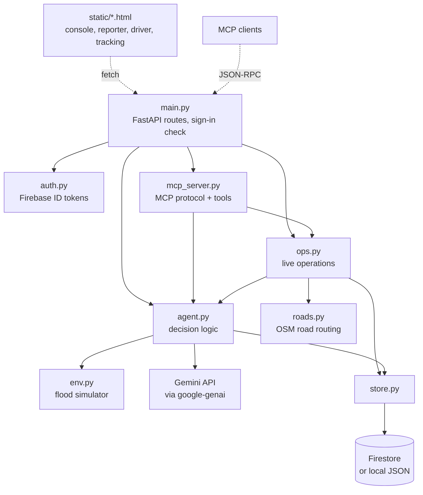
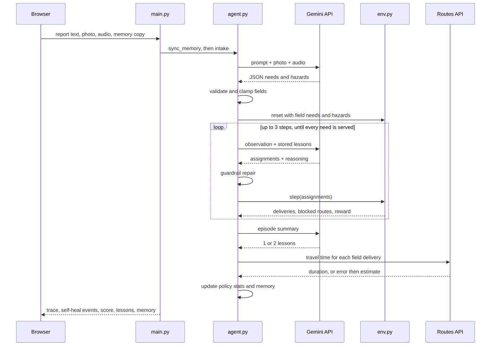
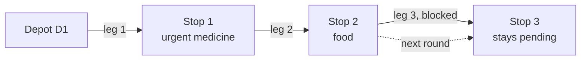
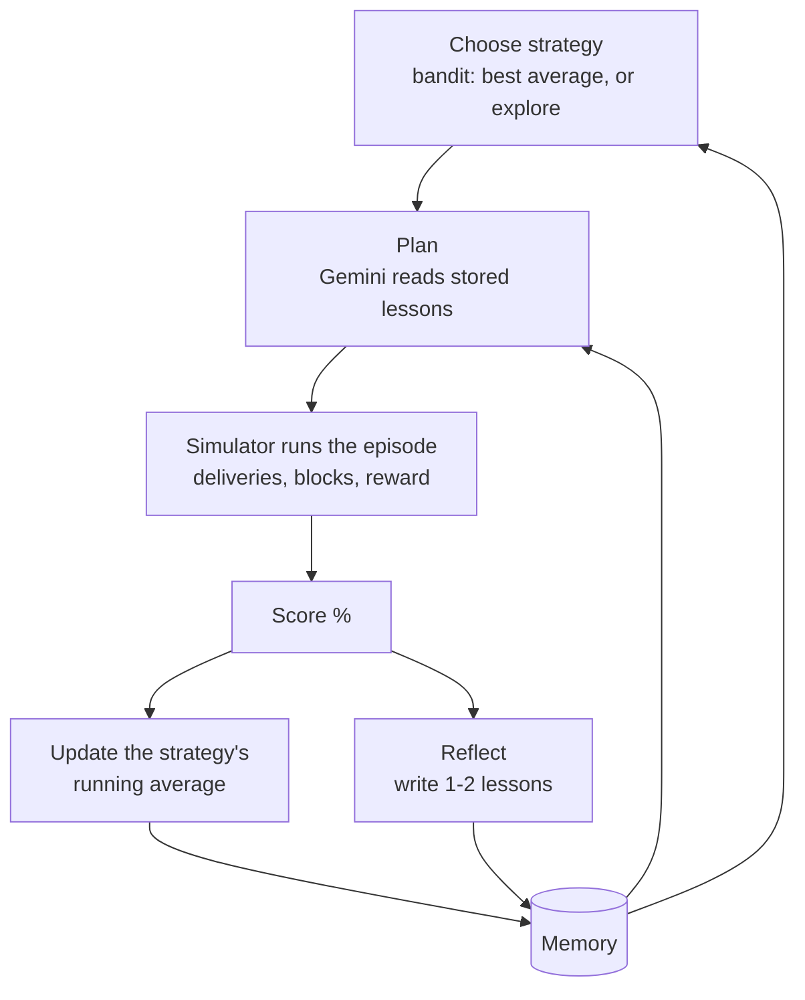
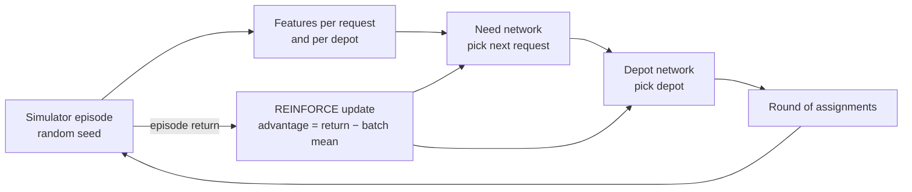
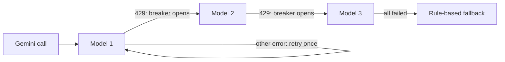
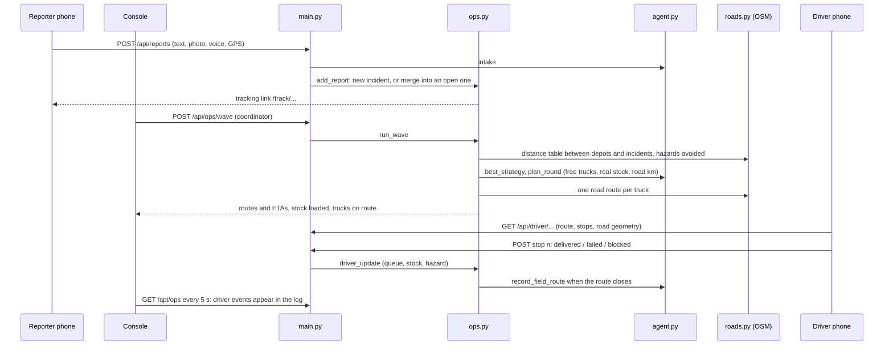

# ReliefRoute architecture

This document explains how ReliefRoute works internally. For setup and a quick tour, see the [README](../README.md).

1. [Modules](#1-modules)
2. [Lifecycle of a dispatch](#2-lifecycle-of-a-dispatch)
3. [The simulator](#3-the-simulator)
4. [Reward and score](#4-reward-and-score)
5. [Planning strategies and the guardrail](#5-planning-strategies-and-the-guardrail)
6. [The learning loop](#6-the-learning-loop)
7. [Self-healing](#7-self-healing)
8. [Multimodal intake](#8-multimodal-intake)
9. [MCP server](#9-mcp-server)
10. [Deployment and state](#10-deployment-and-state)
11. [Tests](#11-tests)
12. [Live operations](#12-live-operations)

---

## 1. Modules



| Module | Responsibility |
|---|---|
| `env.py` | Builds a flood scenario, executes delivery plans, injects the disruption, computes the reward. Pure Python, no I/O. |
| `agent.py` | Everything the agent decides: intake, strategy choice, planning, plan repair, model failover, travel times, reflection, memory. |
| `main.py` | HTTP layer. Turns requests into calls on `agent.py` and returns JSON. |
| `mcp_server.py` | Implements the MCP methods and maps five tools onto `agent.py` and `ops.py`. |
| `static/index.html` | The console: report form, pipeline, map, event log, performance panel. One file, no build step. |
| `policy.py` | Features and decision procedure of the learned policy, plus inference in plain Python from `policy_weights.json`. |
| `rl/train_policy.py` | Trains the policy with REINFORCE in PyTorch. Only needed offline. |
| `relief_openenv/` | The simulator wrapped as an OpenEnv environment (typed models, server, client, manifest). |
| `ops.py` | Live operations: incident queue and duplicate merging, dispatch waves, routes, driver updates, resources, tracking, situation reports. |
| `roads.py` | Road distance tables and truck routes from a Valhalla server on OpenStreetMap, with hazards as areas to avoid; straight-line fallback. |
| `auth.py` | Coordinator sign-in: verifies Firebase ID tokens and checks the coordinator list. |
| `store.py` | Shared state storage: Cloud Firestore (REST, conditional writes with retry) or local JSON files. |
| `static/report.html`, `static/track.html`, `static/driver.html` | Field reporter page, the reporter's status page, and the driver's route page. |

## 2. Lifecycle of a dispatch

What happens when someone submits a report on the web app (`POST /api/dispatch`):



If any Gemini call fails, that step falls back to a local method instead of failing the request (see [section 7](#7-self-healing)). With the free-tier model, a typical dispatch takes 6–10 seconds.

## 3. The simulator

`env.ReliefEnv` follows the OpenEnv environment contract, so the same environment can later back RL training.

| Method | Returns |
|---|---|
| `reset(seed, extra_needs, extra_hazards, chaos, n_needs=5)` | Initial observation |
| `step(action)` | `{"observation", "reward", "done", "info"}` |
| `state()` | Full episode state, including history and total reward |

**Action**

```json
{"assignments": [{"need_id": "R1", "depot_id": "D2", "detour": false, "truck_id": "D2-T1"}]}
```

The order of the list is the loading order. Each truck visits its stops in the order they were assigned to it. `truck_id` is optional: without it, the depot's truck that is free earliest takes the stop.

**Observation**

| Field | Contents |
|---|---|
| `depots` | Id, name, coordinates, current stock per item, truck ids |
| `truck_capacity` | Units one truck can carry in a round |
| `pending_needs` | Unserved requests: zone, coordinates, item, remaining quantity, urgency 1–5, source (`sim` or `field`) |
| `known_hazards` | Flood zones and collapses reported so far |
| `route_matrix` | For every pending need and depot: distance in km, and which hazards the route crosses |
| `step`, `max_steps` | Progress through the episode |

**World parameters**

| Parameter | Value |
|---|---|
| Depots | 3 real locations: Guindy, Anna Nagar, Tondiarpet |
| Stock | 60–260 units of each of water, food, medicine, blankets, per depot |
| Simulated requests | 5 per episode, in 10 Chennai localities, 30–150 units, urgency 1–5 |
| Field requests | Added from the report, ids `R1`, `R2`, … |
| Fleet | 2 trucks per depot, 250 units each per round. Trucks start each round empty at their depot. |
| Flood zones | 1–2 random, radius 1.0 km. Hazards from the report have radius 0.8 km. |
| Disruption | On step 1, a bridge collapse (radius 0.6 km) at the midpoint of the longest leg the trucks are about to drive without a detour |
| Distance | Straight line in a local projection, multiplied by 1.3 for road winding |
| Detour | Distance multiplied by 1.6. A detour always gets through. |
| Speed | 25 km/h |
| Episode length | Ends when every need is served, or after 3 steps |

**Rules applied in each step (one dispatch round)**
- Invalid assignments are ignored and counted in `info.invalid`: unknown ids, needs already served, and duplicate assignments for the same need.
- Each assignment is loaded onto a truck of its depot. If every truck at that depot is full, it goes to `info.no_truck` and the need stays pending.
- A truck drives **leg by leg**: depot → first stop → second stop, and so on. Each leg is checked against every hazard circle. A blocked leg without `detour` fails; the truck stays where it is and carries on to its next stop.
- The amount delivered is the smallest of: what the need still requires, the depot's stock, and the truck's remaining capacity. The rest of the need stays pending for the next round.
- Arrival time accumulates along the route, so the third stop of a truck arrives later than its first.



## 4. Reward and score

For each step:

```
delivered   +  urgency × 10 × delivered_qty / requested_qty
            −  urgency × arrival_hours × 4      (arrival_hours = km driven by that truck so far / 25)
blocked     −  5
no stock    −  2
no truck    −  2
```

When the episode ends, every request still not fully served costs:

```
−  urgency × 10 × undelivered_qty / requested_qty
```

The score shown in the app normalises this against the best case, where every request is fully served with zero travel time:

```
score % = max(0, 100 × total_reward / Σ(urgency × 10))
```

Normalising makes easy and hard episodes comparable, which is what the learning loop needs.

## 5. Planning strategies and the guardrail

| Strategy | Order | Depot choice | Floods |
|---|---|---|---|
| `llm` | Gemini decides | Gemini decides, from the observation and stored lessons | Gemini is told to detour around `blocked_by` routes, and the guardrail enforces it |
| `rl_policy` | Learned (need network) | Learned (depot network); pins the depot's earliest-free truck | Detours when the actual leg (previous stop to this stop) crosses a known hazard |
| `urgency_first` | Most urgent first | Nearest depot with enough stock | Detours around known hazards |
| `nearest_first` | Arrival order | Nearest depot with enough stock | Detours around known hazards |
| `fifo` | Arrival order | First depot with any stock | Ignores hazards |

`fifo` is a deliberately naive baseline. It gives the learning loop a clearly bad option to learn to avoid.

**Guardrail** (`agent.repair`). Every Gemini plan goes through these checks before it reaches the simulator:
1. Assignments with an unknown need or depot, or a duplicate need, are dropped.
2. Assignments whose route crosses a known hazard without a detour are switched to a detour.
3. Pending needs that the plan left out are filled in with `urgency_first`.

Each correction is logged as a `GUARDRAIL` event.

## 6. The learning loop



**Offline RL: the `rl_policy` strategy** (`policy.py`, `rl/train_policy.py`)



- Each network is one tanh hidden layer of 24 units. The need network scores every pending request, and sampling from its softmax picks the next one to load (this sets the stop order). The depot network then scores the depots that have both stock and a truck with space.
- While deciding, `policy.decide` simulates the fleet the same way the simulator loads it (`_fleet`, `_truck_for`). Features use the real arrival time, the actual leg and whether it crosses a known hazard, and the truck's remaining space. The resulting plan pins each stop to that truck (`truck_id`), so what the policy imagined is exactly what gets driven.
- `policy.decide` is written without any framework, so training (PyTorch tensors, sampled choices) and serving (plain floats, greedy choices) run exactly the same procedure.
- Training: 32,000 episodes, Adam with learning rate 0.005, return = reward / best possible reward. The baseline is **group-relative** (as in GRPO): each scenario is played 8 times per update, and an attempt's advantage is its return minus the mean return of its group, normalised over the batch.
- Evaluation: 500 scenarios with seeds disjoint from training, all with the bridge collapse on. Results are in `rl/results.json`: 78.0% untrained, 80.6% trained, against 80.0% for `urgency_first`.
- Paired over the same 500 scenarios: +0.57 points (95% CI +0.33 to +0.81), with 155 wins, 238 ties and 107 losses.
- Best-of-40 sampled plans with hindsight reach about 82.5% on 100 of these scenarios, which is an estimate of the remaining headroom.

**Online policy selection: an epsilon-greedy bandit** (`agent.select_strategy`)
- Strategies that have never been tried are tried first.
- After that, 80% of the time it picks the strategy with the best average score; 20% of the time it picks one at random, so a strategy that has improved can be rediscovered.
- After each episode, that strategy's average is updated incrementally with the new score.
- `llm` is only an option when a Gemini key is configured, and `rl_policy` only when `policy_weights.json` is present.
- Training runs use the bandit. Dispatches from the web app always use `llm` when available, because only Gemini can read photos, audio and non-English text.

**Reflection** (`agent.reflect`)
- After an `llm` episode, Gemini receives the episode summary (rewards, blocked routes, stockouts, unmet needs, self-heal events) plus the existing lessons. It writes one or two new, concrete lessons.
- After a rule-based episode, lessons are written by rules: blocked deliveries lead to a lesson about checking hazards, unmet needs lead to a lesson about urgency.
- Lessons are deduplicated. The latest 8 are kept and inserted into every later Gemini planning prompt.

**Memory format**

```json
{
  "lessons": ["Avoid single-bridge corridors when alternative paths exist."],
  "episodes": [{"n": 1, "strategy": "urgency_first", "reward": 112.1, "score": 88.6, "heals": 2, "ts": 1792224867}],
  "bandit": {"llm": {"n": 1, "mean": 73.4}, "urgency_first": {"n": 4, "mean": 88.6},
             "nearest_first": {"n": 1, "mean": 76.8}, "fifo": {"n": 1, "mean": 19.9}}
}
```

The latest 200 episodes are kept.

## 7. Self-healing

| Failure | How it is detected | Recovery | Log tag |
|---|---|---|---|
| Route blocked mid-delivery | `info.blocked` from the simulator | Need stays pending, then is replanned next step (detour or another depot) | `ALERT`, `REROUTE` |
| No truck capacity left at a depot | `info.no_truck` from the simulator | Need stays pending and is loaded in the next round | `STEP n` |
| Gemini plan is invalid or unsafe | Guardrail checks against the observation | Drop, force a detour, or fill the gap with `urgency_first` | `GUARDRAIL` |
| Gemini model out of quota (HTTP 429) | Error text `RESOURCE_EXHAUSTED` | Circuit breaker skips that model for 5 minutes, then the next model is tried immediately | `FAILOVER` |
| Gemini transient error or bad JSON | Exception from the call or the parser | Retry once with backoff, then the next model | `FAILOVER` |
| Every Gemini model fails | All attempts raise | Intake: keyword rules. Planning: `urgency_first`. Reflection: rule-based lessons. | `FALLBACK` |
| Routes API fails (simulator ETAs) | HTTP error or timeout (8 s) | Estimate from distance at 25 km/h | `FALLBACK` |
| Road router unreachable or too many stops (live) | HTTP error, timeout (12 s), or more than 40 points | Plan and route on straight-line estimates; the route is drawn dashed and labelled "estimate" | `FALLBACK` |
| Driver reports a blocked road | Stop outcome `blocked` | New hazard at the driver's GPS position, incident back in the queue, next wave's router avoids the area | `BLOCKED`, `REROUTE` |
| Delivery fails or a route is recalled | Stop outcome `failed`, or recall | Incident back in the queue with the reason; unused cargo back into stock; truck free again | `DRIVER` |
| A truck leaves on another route while a wave is planned | Truck not idle when the wave is applied | That truck's stops stay queued for the next wave | `FALLBACK` |
| The same need is reported twice | Same item, open, within 0.5 km and 12 hours | Merged into one request (larger quantity, higher urgency) | `MERGED` |
| Two instances write the operation at once | Firestore precondition fails | Re-read and retry the change on fresh data | – |
| Serverless instance lost its memory (file storage only) | Browser copy has more episodes than the server's | Server adopts the browser copy after sanitising it | – |



The model order comes from `GEMINI_MODELS`. The live deployment uses `gemini-3.5-flash-lite`, then `gemini-flash-latest`, then `gemini-3.8-flash`. Requests ask for JSON output (`response_mime_type: application/json`) at temperature 0.2.

## 8. Multimodal intake

`agent.intake` sends the report text, plus any photo and audio as inline parts, to Gemini in one request. Gemini returns:

```json
{"summary": "...", "language": "Tamil-English (Tanglish)",
 "needs": [{"zone": "Velachery", "lat": 12.98, "lng": 80.22, "item": "water", "qty": 120, "urgency": 5, "evidence": "..."}],
 "hazards": [{"label": "road flooded", "lat": 13.02, "lng": 80.22}]}
```

**Validation applied to Gemini's output**
- `item` is mapped onto one of water, food, medicine, blankets.
- Coordinates must fall inside the Chennai area (lat 12.8–13.35, lng 80.0–80.4). Otherwise the locality name is looked up, and if that fails the city centre is used.
- `qty` is clamped to 1–1000 and `urgency` to 1–5, with defaults when they are missing.
- Hazards without numeric coordinates are discarded.

**Keyword fallback** (used when Gemini is unavailable)
- Items are matched on whole words, including common Tamil and Hindi terms: *thanni*, *kudineer*, *paani*, *khana*, *saapadu*, *marundhu*, *dawai*, *kambal*, *porvai*. Every item mentioned becomes its own need.
- The first number in the text is the quantity.
- The locality is matched against the known area names, with T Nagar as the default.
- Words such as *urgent*, *trapped*, *stranded* or *children* set urgency to 5. Otherwise urgency is 3.

**Voice recordings.** Browsers record WebM or Ogg, so the console converts recordings to 16 kHz mono WAV before upload. Uploaded audio files are sent as they are.

## 9. MCP server

`POST /mcp` implements the MCP Streamable HTTP transport in stateless mode, with JSON responses.

| Method | Behaviour |
|---|---|
| `initialize` | Echoes the client's protocol version if supported (`2025-06-18`, `2025-03-26`, `2024-11-05`), otherwise answers with the latest. Advertises the `tools` capability. |
| `ping` | Empty result |
| `tools/list` | The five tools with JSON Schema inputs |
| `tools/call` | Runs the tool. Returns `content` (JSON as text) and `structuredContent`. |
| Notifications | Accepted with HTTP 202 and no body |
| Batches | JSON arrays are processed message by message |

Errors use standard JSON-RPC codes:
- `-32700`: the body is not valid JSON
- `-32600`: the message is not a valid request
- `-32601`: unknown method
- `-32602`: unknown tool

Exceptions inside a tool come back as a normal result with `isError: true`, so the calling model can see what went wrong. `GET /mcp` returns 405, because the server does not open server-initiated streams.

## 10. Deployment and state

**Live hosting.** The app runs on Vercel as a serverless Python function (FastAPI zero-config). Instances start on demand and can be recycled, so state lives in Cloud Firestore:
- The operation and the agent's memory are two Firestore documents, shared by every instance (see section 12).
- Without Firestore (local development), they are `ops.json` and `memory.json`. On Vercel those are in `/tmp`, so an instance restart loses them. For memory, the browser's copy restores learning after such a restart.
- Training sends one episode per request, so no single request runs long and the UI can show progress.

**Cloud Run.** `Dockerfile` builds a container that serves the same app on `$PORT`. It is ready to deploy to Google Cloud Run once a billing-enabled project is available.

**Secrets.** The Gemini key and the Firestore service-account key are encrypted Vercel environment variables. Neither is in the repository. The Firebase web `apiKey` used for sign-in is public by design; it only identifies the project.

**Coordinator sign-in.** When `COORDINATOR_EMAILS` and `FIREBASE_WEB_API_KEY` are set:
- The console loads the Firebase Authentication SDK and signs coordinators in with Google.
- Every request carries the Firebase ID token. `auth.coordinator` verifies its signature, audience and expiry with Google's public keys, requires a verified email on the list, and caches the result until the token expires.
- Waves, resource changes, resets, situation reports and memory resets need a coordinator. Everyone else gets a read-only view without driver links.
- Reporters and drivers never sign in. A reporter's tracking link and a truck's driver link are 16-character random tokens. A new operation issues new driver links.

**Protecting a public deployment.** Rate limits keep one visitor from using up the shared Gemini quota or flooding the operation:

| Limit | Value | Where |
|---|---|---|
| Dispatches per client address | 8 per 10 minutes | `main.check_rate` |
| Training requests per client address | 60 per 10 minutes | `main.check_rate` |
| Costly MCP tool calls (`dispatch_relief`, `parse_field_report`, `train_agent`) | 10 per 10 minutes | `main.mcp` |
| Memory resets | 5 per 10 minutes | `main.check_rate` |
| Field reports | 12 per 10 minutes | `main.check_rate` |
| Waves | 30 per 10 minutes | `main.check_rate` |
| Situation reports | 6 per 10 minutes | `main.check_rate` |
| Resource changes (depots, trucks, restocks, recalls, hazards) | 60 per 10 minutes | `main.check_rate` |
| Driver stop updates | 120 per 10 minutes | `main.check_rate` |
| Gemini calls per server instance per UTC day | `GEMINI_DAILY_BUDGET`, default 300 | `agent._spend_budget` |

When a rate limit is hit, the response is HTTP 429 with `Retry-After`. MCP gets a JSON-RPC error `-32000`. When the daily budget is spent, every Gemini step falls back to its rule-based method, exactly as if the API were down. All counters are in memory per instance, so they are a guard, not an exact global quota.

## 11. Tests

`test_app.py` runs with `OFFLINE=1` and temporary state files. Gemini, the road router and Firebase sign-in are replaced by fakes where a test needs them, so no network access or key is needed.

| Test | What it proves |
|---|---|
| `test_env_contract_reset_step_state` | The simulator follows the reset / step / state contract |
| `test_invalid_actions_are_ignored_not_crashing` | Malformed actions are rejected, not fatal |
| `test_chaos_blocks_a_route_and_agent_heals` | The disruption blocks a route, and that need is delivered in a later step |
| `test_guardrail_repairs_bad_llm_plan` | Invalid Gemini assignments are dropped and the gap is filled |
| `test_learning_updates_memory_and_bandit_prefers_better_policy` | After 12 episodes there are lessons, and the policy does not prefer `fifo` |
| `test_score_is_percentage_of_best_case` | Scores stay within 0–100% across 120 episodes, including split deliveries |
| `test_memory_restored_from_browser_copy_after_cold_start` | Memory survives an instance reset, and malformed copies are ignored |
| `test_quota_circuit_breaker_skips_exhausted_model` | A 429 opens the breaker. The next call skips that model without retrying. |
| `test_mcp_protocol_and_tools` | Handshake, notifications, tool listing, a tool call and error codes |
| `test_offline_intake_extracts_need` | Keyword intake handles English and Tanglish, and does not read "underwater" as a water request |
| `test_api_end_to_end` | Web page, dispatch with an image upload, training, scenario and memory reset |
| `test_truck_capacity_caps_a_single_delivery` | One truck never carries more than its capacity; the rest waits for the next round |
| `test_multi_stop_route_is_driven_in_order` | Stops are numbered in loading order, arrivals are non-decreasing, each leg starts at the previous stop |
| `test_no_truck_when_depot_fleet_is_full` | Assignments beyond the depot's fleet are reported as `no_truck` |
| `test_policy_decide_serves_every_stocked_need` | The policy's decision procedure produces a valid plan covering every request that has stock |
| `test_trained_policy_runs_without_pytorch` | The exported weights drive a full episode with no PyTorch installed |
| `test_openenv_environment_and_server` | The OpenEnv environment plays a full episode, and its server answers `/health` and `/schema` (skipped without `openenv`) |
| `test_rate_limits_per_client` | REST and MCP limits trigger per client address. Cheap MCP methods are never limited. |
| `test_daily_gemini_budget_degrades_to_rules` | The daily Gemini budget refuses calls once spent |
| `test_firestore_writes_never_lose_a_concurrent_update` | Against a fake Firestore with real preconditions: a write that races another instance is rejected and retried, and both changes survive |
| `test_operations_and_memory_run_on_firestore` | A report, a wave and a training episode all persist through the Firestore backend |
| `test_operations_report_wave_driver_and_sitrep_over_the_api` | Over HTTP:<br/>- a phone report placed by GPS, with a working tracking link<br/>- a wave loading exactly the dispatched units off the depots and sending trucks out<br/>- the driver page and route, a driver closing a route<br/>- a repeated stop and an unknown link rejected<br/>- situation report, reset, empty-queue 409 |
| `test_duplicate_reports_merge_instead_of_sending_two_trucks` | Same need nearby merges (larger quantity, higher urgency, report count); another place does not |
| `test_failed_and_blocked_stops_return_to_queue_and_teach_the_agent` | A short delivery, a blocked road and a failed delivery:<br/>- queue and notes<br/>- a hazard at the driver's GPS<br/>- cargo returned to stock, trucks free<br/>- lessons, the ETA correction learned from a late arrival, and the next wave using it |
| `test_recall_resources_and_their_guards` | Recall; new depot (outside Chennai refused); new truck (bad capacity refused); restock (unknown item refused); out of service (refused while on a route); closing a request |
| `test_hazards_are_avoided_by_the_router_and_can_be_cleared` | Against a fake router: hazards sent as excluded areas, road geometry decoded, a hazard cleared; with the router down, the wave falls back to estimates and logs it |
| `test_coordinator_sign_in_guards_every_change` | With sign-in on: no token, a wrong account and a forged token all get 401 on every protected action; reporters still report; driver links are hidden from the public view; the coordinator's email is recorded |
| `test_sitrep_stock_alerts_are_never_left_to_gemini` | Stock alerts come from the exact rule even when Gemini writes the report |

## 12. Live operations

`ops.py` turns the agent from "one report, one episode" into a running operation with real trucks, drivers and outcomes.



**Operation state** (one document, `reliefroute/ops`):

| Field | Contents |
|---|---|
| `depots` | `id`, name, coordinates, `stock` per item. Starts with three depots at 400 units of each item; coordinators open more. |
| `trucks` | `id`, `depot_id`, `capacity`, `status` (`idle`, `on_route`, `out_of_service`), `route_id`, and `token` (the secret in its driver link) |
| `incidents` | `id`, zone, coordinates, item, `requested`, `qty` (still to send), `assigned` (on trucks), `delivered`, urgency, `status` (`waiting`, `en_route`, `delivered`, `closed`), `reports` (merged count), source, `located_by`, `note`, times |
| `routes` | `id`, wave, truck, depot, `status` (`active`, `done`), strategy, `km`, `minutes`, `source` (`road` or `estimate`), `shape` (road geometry, at most 300 points), `eta_factor`, and `stops` (`n`, incident, item, `qty`, `eta_raw`, `eta_min`, `status`, `delivered_qty`, `note`, `at`) |
| `hazards` | `id`, label, coordinates, `radius_km`, source (`console`, `phone`, `driver`), `active` |
| `reports` | One per field report: tracking `token`, time, source, the incidents it created or merged into |
| `waves`, `restocks`, `log` | History, incoming supplies, and an activity log of who did what |
| `version`, `schema` | Change counter; document format (an older format is replaced by a fresh operation on first use) |

An incident's status follows from its quantities: `waiting` while some of it still has to be sent (`qty > 0`), `en_route` while the rest is on trucks, `delivered` when both are zero, `closed` when a coordinator closed it.

**A wave**
1. It takes every waiting incident, the trucks that are `idle` (with their own capacities) and the depots' current stock.
2. It asks the road router for a distance table between all of those points, with every active hazard as an area to avoid. While planning, `env.road_distances` installs that table, so the simulator, the rule strategies and the learned policy all see road kilometres. A pair the router connected is never treated as crossing a hazard, because its road route already goes around it.
3. It plans one round with `agent.best_strategy` (the strategy with the best average score, excluding `fifo`) inside a simulator episode that contains only these incidents, depots and trucks.
4. For each truck with stops, it asks the router for the road route through the stops in order. That gives the geometry the driver sees and the drive time of every leg.
   - The ETA of stop *k* is the drive time up to it, plus 10 minutes of unloading at each earlier stop, multiplied by the learned `eta_factor`.
5. It applies the result in one atomic update, re-checking everything against fresh data (a report or a driver may have changed things meanwhile):
   - Stock is taken off the depot.
   - `qty` moves to `assigned`.
   - The truck becomes `on_route`.
   - A truck that became busy in between keeps its stops queued.

If the router fails or the wave has more than 40 points, planning and routes use straight-line estimates, and the log says which.

**Drivers** (`/driver/<token>`) see their route on a map, with the stops in order, ETAs and a link to open each stop in their navigation app. For each stop they record:

| Outcome | Effect |
|---|---|
| `delivered` (all, or a smaller quantity) | `delivered` grows; any shortfall goes back to `qty`, so it is still dispatched |
| `failed`, with a reason | The quantity goes back to `qty`; the reason is shown on the incident |
| `blocked`, with a note and GPS | As failed, plus a new 0.5 km hazard at the driver's position (or halfway along the leg without GPS) |

When the last stop is recorded the route closes:
- Unused cargo returns to the depot's stock.
- The truck is free again.
- The outcome goes to `agent.record_field_route`.

A coordinator can also recall a route; its unvisited stops are `skipped` and return to the queue.

**Learning from the field** (`agent.record_field_route`):
- **Score:** the urgency-weighted share of the loaded relief that was delivered, averaged per strategy in `memory.field`.
- **ETA correction:** each delivered stop with a plausible arrival time moves `eta_factor` 20% of the way towards actual / router estimate, clamped to 0.5–3. A stop counts when it was recorded at least 30% of the estimate after dispatch, so taps seconds after dispatch do not count. Every later ETA uses the new factor.
- **Lessons:** failed and blocked stops become lessons ("road to Velachery was blocked …"), which the Gemini planner reads with the others.

**Duplicate merging.** A new need is merged into an existing incident when all of these hold:
- same item
- the incident is still open
- within 0.5 km
- reported in the last 12 hours

The larger requested quantity and the higher urgency win, a GPS position improves a guessed one, and `reports` counts the reports. The reporter is told their report was added to an existing request, and their tracking link follows it.

**Tracking** (`/track/<token>`) shows a reporter only the incidents from their own report: received, truck on the way (with the earliest ETA), delivered, and whether an earlier truck could not get through.

**Storage and several instances** (`store.py`). With `FIREBASE_SERVICE_ACCOUNT` set, the operation and memory are Firestore documents (`reliefroute/ops`, `reliefroute/memory`, one string field `json`), read and written over the Firestore REST API with a service-account token.
- Every write carries the `updateTime` from its read as a precondition (`currentDocument.exists=false` for the first write).
- If another instance wrote in between, Firestore rejects the write and the change is retried on fresh data. So a phone report, a wave and a driver update handled by three different instances never overwrite each other.
- An update that fails validation (for example a stop already recorded) raises before anything is written.
- Without Firestore the documents are local JSON files guarded by a process lock. That is fine for one instance, not for several.

**Situation report.** `ops.sitrep` assembles the facts: figures, per-area waiting needs with wait times, relief on trucks, active routes, hazards, stock and recent waves. Gemini turns them into headline, overview, priorities, blocked roads and actions, using only that data, and the output is validated and truncated field by field. Stock alerts are a threshold fact, so they always come from the rule and Gemini never sees raw stock levels; in testing it flagged healthy depots as alerts. Without Gemini, `_rule_sitrep` produces the same sections deterministically, including routes out for more than two hours.
